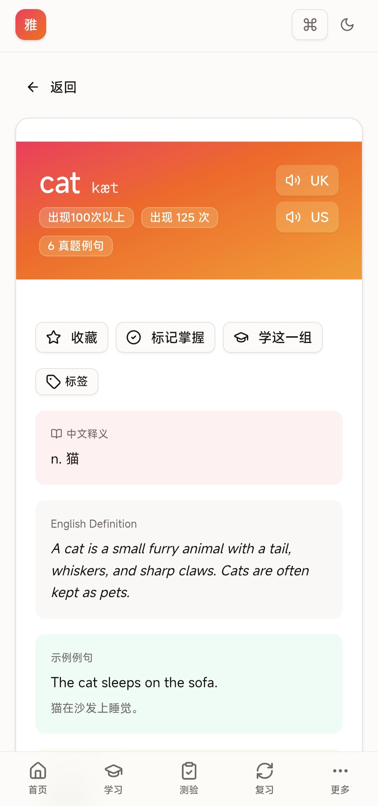
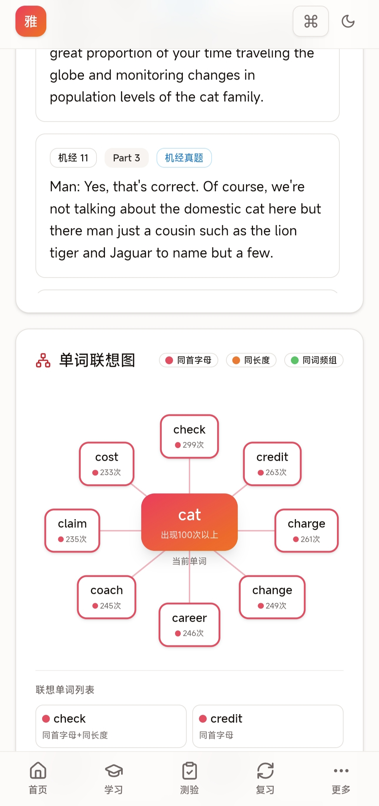

# 📖 雅思词汇通 - IELTS Vocabulary Master

> 基于剑桥雅思 4-19 真题语料的高频词汇学习平台

[](https://nextjs.org/)
[](https://www.typescriptlang.org/)
[](https://tailwindcss.com/)
[](LICENSE)

## 项目预览






## ✨ 功能特性

### 📚 数据规模
- **34,212 个高频单词**（6 个词频分组，出现 3 次以上）
- **76,332 条真题例句**（来自剑桥雅思 4-19 + 机经真题）
- 每词含：音标、中文释义、英英释义、记忆法、英美发音、真题例句

### 🎯 10 大功能模块

| 模块 | 功能说明 |
|------|----------|
| 🏠 **首页** | 渐变 Hero、学习日历热力图、每日目标进度环、测验统计仪表盘、模式排行榜、成就徽章、正确率趋势图 |
| 📖 **浏览词库** | 词频分组筛选、首字母筛选、搜索（debounce）、4 种排序、分页、滚动位置恢复 |
| 🎓 **翻卡学习** | 翻卡动画、英美音发音、键盘快捷键（空格翻卡/←→切换/1/2/3 评级）、自动播放、学完"换一批"提示 |
| 📝 **单词测验** | 3 种模式（英→中/中→英/词→句）、4 级难度（自适应/简单/中等/困难）、错题优先、计时模式、S/A/B/C/D 评级 |
| ⌨️ **拼写测验** | 3 种提示（中文/音标/听发音）、3 级渐进提示（首尾→中间→更多）、Levenshtein 距离判定 |
| 📄 **例句填空** | 真题例句挖空、3 级渐进提示、词形识别 |
| 🔄 **智能复习** | 艾宾浩斯遗忘曲线算法、6 级间隔（4h/12h/1d/3d/7d/14d）、翻卡复习、记忆率统计 |
| ⭐ **收藏管理** | 3 标签页（收藏/学习中/已掌握）、自定义标签（10 色）、批量操作、导出/导入 JSON |
| 🔍 **单词详情** | 释义/英英/例句/记忆法、发音跟读（Web Speech API）、单词联想图、真题出处统计、相关词推荐、标签管理 |
| ⚙️ **设置** | 深色模式、发音口音、自动播放、每日目标、数据管理 |

### 🛠 技术特性
- ✅ **深色模式** — 主题持久化 + 系统偏好检测 + FOUC 防闪
- ✅ **PWA** — manifest + service worker + 离线 app shell 缓存
- ✅ **URL hash 路由** — 浏览器后退/前进支持 + 滚动位置恢复
- ✅ **移动端** — 底部 tab bar + "更多"菜单 + 响应式布局
- ✅ **Cmd+K 命令面板** — 全局搜索单词 + 快捷导航
- ✅ **成就系统** — 11 个成就徽章 + 解锁 toast 通知 + confetti 庆祝
- ✅ **数据加载进度条** — 静态模式按字母分块加载 + 实时进度
- ✅ **Cloudflare Workers 部署就绪** — 静态数据模式 + OpenNext 适配

---

## 🚀 快速开始

### 环境要求
- Node.js 18+ / Bun 1.0+
- SQLite（开发模式）

### 安装

```bash
# 克隆仓库
git clone https://github.com/yourname/ielts-vocab-master.git
cd ielts-vocab-master

# 安装依赖
bun install

# 初始化数据库
bun run db:push

# 加载数据（需要先下载源数据）
bun run scripts/load-data.ts

# 启动开发服务器
bun run dev
```

打开 `http://localhost:3000` 即可使用。

### 构建生产版本

```bash
# 标准构建（需要数据库）
bun run build

# Cloudflare Workers 部署构建（静态数据模式）
bash scripts/build-cloudflare.sh
```

---

## ☁️ Cloudflare Workers 部署

本项目支持 Cloudflare Workers 静态部署，无需后端服务器。

### 部署步骤

1. **Fork 仓库** 并推送到 GitHub

2. **在 Cloudflare Dashboard 创建 Workers 项目**：
   - Framework preset: Next.js
   - Build command: `bash scripts/build-cloudflare.sh`
   - Build output directory: `out`
   - 环境变量: `NEXT_PUBLIC_STATIC_DATA=true`

3. 或者使用 **Wrangler CLI**：
   ```bash
   npm install -g wrangler
   wrangler login
   bash scripts/build-cloudflare.sh
   wrangler pages deploy out --project-name ielts-vocab
   ```

### 架构说明

- **静态数据**: 34,212 词导出为 63 个 JSON 文件（按字母/wordId 分块）
- **客户端数据层**: `src/lib/static-api.ts` 模拟全部 API，从 JSON 文件读取
- **环境变量** `NEXT_PUBLIC_STATIC_DATA=true`: 启用静态模式

详细说明见 [CLOUDFLARE-DEPLOY.md](CLOUDFLARE-DEPLOY.md)

---

## 🏗 项目结构

```
├── src/
│   ├── app/
│   │   ├── api/              # 13 个 API 路由（开发模式用）
│   │   ├── page.tsx          # 主页面（单页应用）
│   │   ├── layout.tsx        # 全局布局
│   │   └── globals.css       # 全局样式
│   ├── components/
│   │   ├── views/            # 10 个视图组件
│   │   │   ├── home-view.tsx
│   │   │   ├── browse-view.tsx
│   │   │   ├── study-view.tsx
│   │   │   ├── quiz-view.tsx
│   │   │   ├── spelling-view.tsx
│   │   │   ├── cloze-view.tsx
│   │   │   ├── review-view.tsx
│   │   │   ├── favorites-view.tsx
│   │   │   ├── word-detail-view.tsx
│   │   │   └── settings-view.tsx
│   │   ├── nav-bar.tsx           # 顶部导航
│   │   ├── mobile-tab-bar.tsx    # 移动端底部 tab
│   │   ├── command-palette.tsx   # Cmd+K 命令面板
│   │   ├── confetti.tsx          # 庆祝动画
│   │   ├── study-heatmap.tsx     # 学习日历热力图
│   │   ├── daily-goal-card.tsx   # 每日目标进度环
│   │   ├── achievements-card.tsx # 成就徽章
│   │   ├── quiz-trend-chart.tsx  # 正确率趋势图
│   │   ├── leaderboard-card.tsx  # 排行榜
│   │   ├── pronunciation-practice.tsx  # 发音跟读
│   │   ├── word-association-graph.tsx  # 单词联想图
│   │   ├── source-stats.tsx      # 真题出处统计
│   │   └── ...                   # 更多组件
│   ├── hooks/
│   │   ├── use-audio.ts          # 音频播放
│   │   └── use-pronunciation.ts  # 语音识别
│   ├── lib/
│   │   ├── api.ts                # API 客户端（支持静态/动态切换）
│   │   ├── static-api.ts         # 静态数据客户端
│   │   ├── review.ts             # 艾宾浩斯复习算法
│   │   ├── achievements.ts       # 成就系统
│   │   └── types.ts              # 类型定义
│   └── store/
│       ├── progress.ts           # 学习进度（Zustand + localStorage）
│       └── ui.ts                 # UI 状态 + URL hash 路由
├── public/
│   ├── data/                 # 63 个静态 JSON 数据文件
│   ├── manifest.json         # PWA manifest
│   ├── sw.js                 # Service Worker
│   └── icon-*.png            # PWA 图标
├── prisma/
│   └── schema.prisma         # 数据库 schema
├── scripts/
│   ├── load-data.ts          # 数据加载脚本
│   ├── load-group6.ts        # 增量加载低频词
│   ├── cleanup-duplicates.ts # 数据去重清理
│   └── build-cloudflare.sh   # Cloudflare 构建脚本
└── docs/
    └── screenshots/          # 项目截图
```

---

## 🧠 技术栈

| 技术 | 用途 |
|------|------|
| **Next.js 16** | 全栈框架（App Router + Turbopack） |
| **TypeScript 5** | 类型安全 |
| **Tailwind CSS 4** | 样式系统 |
| **shadcn/ui** | UI 组件库（New York 风格） |
| **Prisma ORM** | SQLite 数据库 ORM |
| **Zustand** | 状态管理（持久化到 localStorage） |
| **Recharts** | 图表可视化（趋势图） |
| **Web Speech API** | 语音识别（发音跟读） |
| **Sonner** | Toast 通知 |

---

## 📊 数据来源

- **数据源**: [FLDC](https://fldc.pages.dev/) 剑桥雅思真题词频数据
- **覆盖范围**: 剑桥雅思 4-19 真题 + 机经真题
- **数据清理**: 已去除重复例句和记忆法（2,085 个单词清理）

---

## 📄 License

[MIT License](LICENSE) - 本项目仅供个人学习使用，数据版权归原作者所有。

---

---

## ❤️ 特别感谢

[Linux.do](https://linux.do) - 一个有爱论坛

---

## 🙏 致谢

- [FLDC](https://fldc.pages.dev/) - 剑桥雅思真题词频数据
- [shadcn/ui](https://ui.shadcn.com/) - UI 组件库
- [Next.js](https://nextjs.org/) - React 全栈框架
